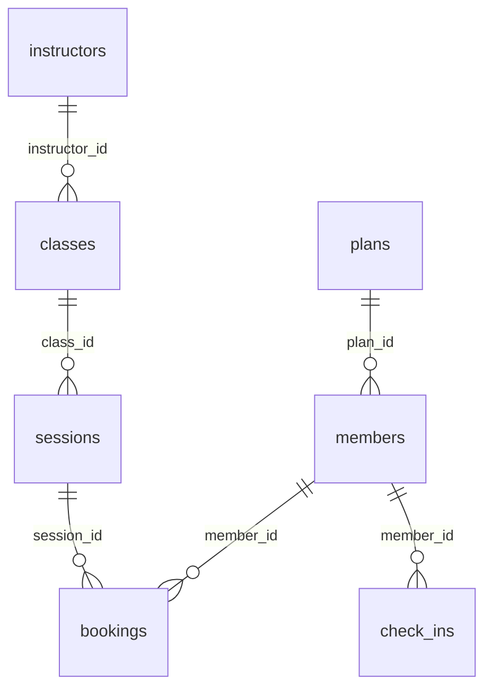

# Gym Membership & Commercial Performance Analysis - Data Dictionary

## Dataset overview

This project uses a sample gym membership and class-booking dataset to explore the commercial and operational performance of a **small community gym**. It is a portfolio case study, not a report on an identified real gym. No geographic location or luxury positioning is assumed.

**Source:** [Gym Memberships and Class Bookings Dataset](https://databasesample.com/datasets/gym-memberships-and-class-bookings-dataset)

| Metric | Value |
|---|---:|
| Source tables | 7 |
| Original records | 2,080 |
| Source columns | 36 |
| Missing values | 0 |
| Orphan foreign keys | 0 |
| Class session coverage | 5 May – 6 July 2025 |
| Gym check-in coverage | 5 May – 29 June 2025 |

### Contents

- [Relationships](#relationships)
- [Table dictionary](#table-dictionary)
- [Data quality and coverage](#data-quality-and-coverage)
- [Cleaning and reporting approach](#cleaning-and-reporting-approach)
- [Limitations and assumptions](#limitations-and-assumptions)
- [Validation checks](#validation-checks)

## Relationships

Each source table has an integer primary key named `id`. All six foreign-key relationships resolve successfully in the supplied CSVs. These relationships were inferred from the source and implemented as constraints in MySQL.

A member belongs to one recorded membership plan. An instructor may teach multiple classes, and each class has scheduled sessions. Bookings link members to sessions; check-ins record gym entries independently. There is no direct relationship between an individual check-in and a class booking.

## Table dictionary

The data types below refer to the MySQL schema in `01_create_database_and_tables.sql`, not the text representation in the CSV files. All 36 source fields are defined as `NOT NULL`. Dates use `YYYY-MM-DD`; timestamps use `YYYY-MM-DD HH:MM:SS` without time-zone information.

**PK** = primary key. **FK** = foreign key. A dash indicates that the column is not a key.

### 1. `plans` — 4 records

**Grain:** One row per membership plan. Used to analyse pricing, class allowances and estimated membership income.

| Column | MySQL data type | Key | Description |
|---|---|---|---|
| `id` | INT UNSIGNED | PK | Unique membership plan identifier. |
| `tier` | TINYINT UNSIGNED | — | Membership level, from 1 to 4; equals `id` in this extract. |
| `monthly_fee` | DECIMAL(8,2) | — | Listed monthly plan fee; source currency unspecified. |
| `classes_per_month` | TINYINT UNSIGNED | — | Number of classes included in the monthly allowance. |

| Tier | Monthly fee (GBP assumed) | Monthly class allowance |
|---|---:|---:|
| 1 | £19 | 4 |
| 2 | £39 | 8 |
| 3 | £59 | 12 |
| 4 | £79 | 16 |

### 2. `instructors` — 8 records

**Grain:** One row per fitness instructor. Used to evaluate scheduled teaching workload and class outcomes.

| Column | MySQL data type | Key | Description |
|---|---|---|---|
| `id` | INT UNSIGNED | PK | Unique instructor identifier. |
| `first_name` | VARCHAR(50) | — | Instructor first name; personal information. |
| `last_name` | VARCHAR(50) | — | Instructor surname; personal information. |
| `engagement` | VARCHAR(20) | — | Employment arrangement: `employee` or `freelance`. |
| `qualified_on` | DATE | — | Recorded date the instructor qualified. |

### 3. `members` — 120 records

**Grain:** One row per member. Used for membership segmentation, plan mix and engagement analysis.

| Column | MySQL data type | Key | Description |
|---|---|---|---|
| `id` | INT UNSIGNED | PK | Unique member identifier. |
| `first_name` | VARCHAR(50) | — | Member first name; personal information. |
| `last_name` | VARCHAR(60) | — | Member surname; personal information. |
| `email` | VARCHAR(255) | — | Member email address; personal information. |
| `birth_date` | DATE | — | Member date of birth; personal information. |
| `joined_on` | DATE | — | Recorded membership start date. |
| `plan_id` | INT UNSIGNED | FK → `plans.id` | Membership plan recorded in the current snapshot. |

### 4. `classes` — 14 records

**Grain:** One row per recurring fitness class. Used to compare class popularity, capacity and scheduling.

| Column | MySQL data type | Key | Description |
|---|---|---|---|
| `id` | INT UNSIGNED | PK | Unique class identifier. |
| `title` | VARCHAR(100) | — | Name of the fitness class. |
| `instructor_id` | INT UNSIGNED | FK → `instructors.id` | Assigned instructor. |
| `capacity` | SMALLINT UNSIGNED | — | Maximum number of places per session; 8–13 in the source. |
| `duration_minutes` | SMALLINT UNSIGNED | — | Scheduled class duration in minutes; 45–65. |
| `first_session_at` | DATETIME | — | Start timestamp of the first scheduled occurrence. |

### 5. `sessions` — 112 records

**Grain:** One row per scheduled occurrence of a class. Each of the 14 classes has eight scheduled occurrences in the extract.

| Column | MySQL data type | Key | Description |
|---|---|---|---|
| `id` | INT UNSIGNED | PK | Unique session identifier. |
| `class_id` | INT UNSIGNED | FK → `classes.id` | Class associated with the session. |
| `week_no` | TINYINT UNSIGNED | — | Occurrence number relative to that class's first session, not a calendar-week number. |
| `starts_at` | DATETIME | — | Actual scheduled start date and time. |

### 6. `bookings` — 778 raw records; 745 cleaned records

**Grain:** One recorded booking row in the source. The cleaned view retains one outcome per member-session pair.

| Column | MySQL data type | Key | Description |
|---|---|---|---|
| `id` | INT UNSIGNED | PK | Unique booking record identifier. |
| `session_id` | INT UNSIGNED | FK → `sessions.id` | Session reserved by the member. |
| `member_id` | INT UNSIGNED | FK → `members.id` | Member associated with the booking. |
| `hours_ahead` | SMALLINT UNSIGNED | — | Assumed booking lead time in hours before the session; 1–167 observed. Definition not independently confirmed. |
| `status` | VARCHAR(20) | — | Recorded outcome: `attended`, `cancelled` or `no_show`. |

### 7. `check_ins` — 1,044 records

**Grain:** One recorded gym entry event, not necessarily one unique visit or a class attendance event.

| Column | MySQL data type | Key | Description |
|---|---|---|---|
| `id` | INT UNSIGNED | PK | Unique check-in event identifier. |
| `member_id` | INT UNSIGNED | FK → `members.id` | Member who recorded the entry. |
| `checked_in_at` | DATETIME | — | Timestamp of gym entry. |
| `method` | VARCHAR(20) | — | Entry method: `key_fob`, `app_qr` or `front_desk`. |
| `minutes_inside` | SMALLINT UNSIGNED | — | Recorded visit duration in minutes; 33–132 observed. Unverified because no check-out timestamp is available. |

## Data quality and coverage

The following counts were recalculated from the seven original CSVs. Categories distinguish confirmed structural issues from possible business events and source limitations.

| Finding | Category | Evidence | Treatment |
|---|---|---|---|
| Exact duplicate booking | Data quality | One identical business-field group containing two rows. | Retain one record in the cleaned reporting layer; preserve both originals. |
| Repeated member-session bookings | Data quality / needs confirmation | 31 groups, 64 rows involved, 33 surplus rows; 15 groups have conflicting statuses. | Apply a documented outcome-priority rule; confirm with a booking-system owner before production use. |
| Near-duplicate check-ins | Needs confirmation | 3 consecutive check-ins by the same member within five minutes. | Retain records; investigate possible repeated scans. |
| Overlapping recorded visits | Needs confirmation | 17 consecutive pairs overlap according to `minutes_inside`. | Retain entries; do not assume the duration field is reliable. |
| Multiple daily entries | Needs confirmation | 132 member-date combinations have more than one check-in. | May represent legitimate re-entry; retain all events. |
| Early-morning entries | Needs confirmation | 53 check-ins recorded between 00:00 and 05:59. | Flag; confirm opening hours and timestamp conventions. |
| Incomplete link between attendance and gym entries | Coverage limitation | Only 71 of 497 raw attended bookings have a same-day check-in for that member. | Do not use entry records to confirm or invalidate class attendance. |
| Different observation windows | Coverage limitation | 7 sessions occur after the last recorded check-in. | Use 5 May–29 June for comparisons requiring both data sources. |
| Non-calendar `week_no` | Definition issue | 56 of 112 session occurrence numbers differ from the calendar-week index beginning 5 May. | Derive calendar weeks from `starts_at`. |
| Redundant tier identifier | Definition issue | `tier` equals `id` in all 4 plan records. | Use the plan key for joins and tier for reporting. |
| Unverified duration | Coverage limitation | No check-out timestamp is supplied. | Avoid firm dwell-time conclusions. |

The exact-duplicate group is included in the repeated member-session groups; these findings must not be added together. No original records were deleted. Capacity, attendance and class-allowance findings are evaluated separately as operational or commercial questions, not automatically treated as data errors.

## Cleaning and reporting approach

MySQL separates original data (`club_raw`) from derived analysis and reporting objects (`club_clean`). For each member-session pair, the reporting layer prioritises `attended` over `no_show` over `cancelled`, using the lowest booking ID to break ties. This is an analyst-defined rule, not a verified chronology of booking events.

| Booking reconciliation | Records |
|---|---:|
| Raw booking rows | 778 |
| Surplus rows excluded from analysis | 33 |
| Clean member-session outcomes | 745 |

The cleaned views preserve an audit trail of excluded bookings. Check-ins are retained and flagged rather than deduplicated without evidence. The Power BI reporting layer contains separate date, member, session, booking and check-in views, avoiding multiplication of membership fees or class capacity when aggregating data.

## Limitations and assumptions

- **Sample dataset:** The small community gym is a case-study setting, not a verified organisation or location.
- **No billing records:** Monthly fees are list prices; GBP is a presentation assumption. Estimated income assumes recorded members pay their listed fees in full, not actual revenue or profit.
- **No membership history:** Current plan assignments do not reveal upgrades, downgrades, freezes, cancellations, renewals or active status over time. Churn and customer lifetime value cannot be measured from these data alone.
- **Limited observation period:** Class activity spans 5 May–6 July 2025 (nine calendar-week buckets, with partial schedules in the first and last weeks); check-ins span eight calendar weeks. Seasonal and long-term trends cannot be established.
- **Small sample:** Some segments are small, including Tier 4 with 10 members. Comparisons are descriptive, not proof of causal differences.
- **Booking history unavailable:** No booking-created or cancellation timestamp, waitlist history, room or per-class payment is provided. Simultaneous overbooking cannot be confirmed from final outcomes alone.
- **Visit details unavailable:** Check-ins are entry events, not confirmed unique visits. No check-out times or facility usage records are provided.
- **Staffing and customer attributes:** No instructor pay, ratings, member demographics beyond birth date, acquisition channel, or customer feedback are provided. Instructor comparisons cannot isolate teaching quality from class type and schedule.
- **Privacy:** Names and email addresses appear to be placeholders, but should still be treated as personal information. Exclude member names, emails and full birth dates from public outputs; use anonymous IDs or aggregate results. No individual personal records are included in this dictionary.

## Validation checks

The supplied CSVs were checked independently for completeness, unique identifiers and relationship integrity. The SQL workflow contains additional profiling, anomaly checks and preservation tests.

| Check | Result |
|---|---|
| Source row and column counts | 2,080 rows across 36 fields and 7 tables |
| Missing values | 0 |
| Primary key uniqueness | All 7 tables have unique, non-null IDs |
| Foreign key integrity | 0 unmatched references across all 6 relationships |
| Booking reconciliation | 778 = 745 + 33 |
| Raw data preservation | Original CSVs unmodified; cleaning uses derived views |

See the SQL scripts for the full validation methodology and the advanced SQL analysis guide for KPI definitions, commercial findings and Power BI reporting measures.
