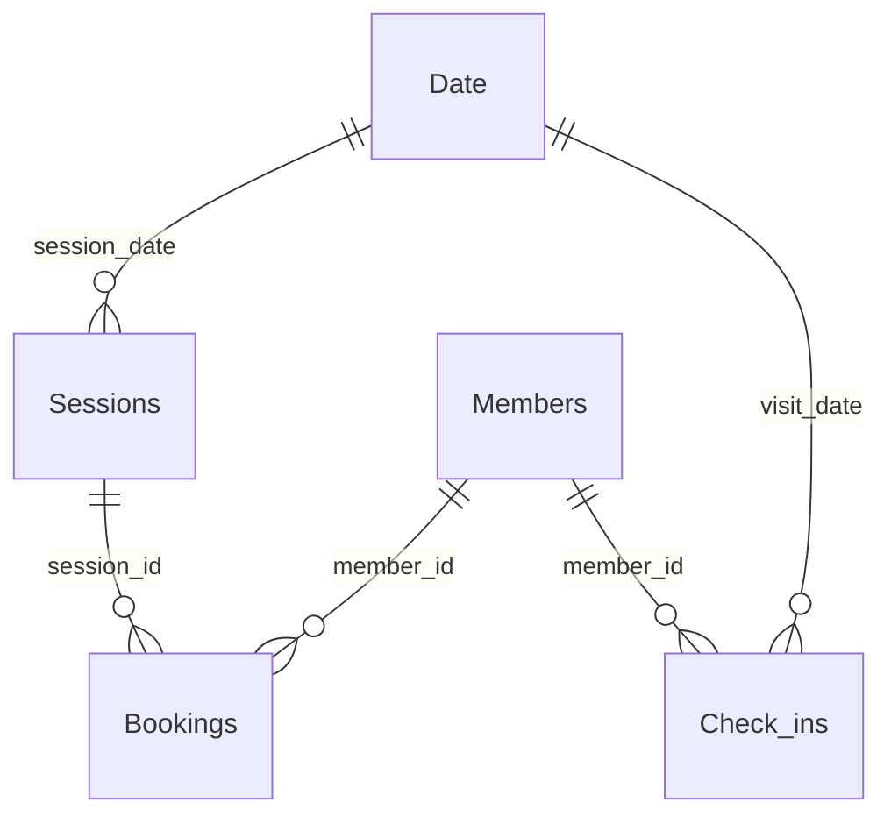

# Advanced SQL Analysis & Reporting Methodology

**Project:** Gym Membership & Commercial Performance Analysis  
**Case-study setting:** A small community gym, using a sample membership and class-booking dataset  
**Environment:** MySQL 8.0.22+, Power BI Desktop and DAX

## 1. Analytical approach

The analysis was designed to identify opportunities to improve membership income, customer engagement and the use of scheduled fitness classes. The central challenge was to establish reliable metrics across related tables with different levels of detail, without inflating counts or drawing conclusions that the source data cannot support.

The workflow separates the original data (`club_raw`) from derived analytical and reporting views (`club_clean`). Scripts 01–08 establish the database, assess data quality and resolve repeated booking records in the reporting layer. Scripts 09–12 translate the prepared data into business metrics and a relational reporting model.

The original tables remain available for audit. The analysis uses one retained record per member-session pair, prioritising `attended`, then `no_show`, then `cancelled`, with the lowest booking ID resolving ties. This is a documented analytical rule rather than a confirmed source-system policy; conflicting records may represent legitimate booking history.

## 2. SQL methodology and analytical rationale

| Script | Business purpose | Analytical approach |
|---|---|---|
| 09 – Membership performance | Assess plan popularity, income concentration and upgrade opportunities | Plan-level aggregation, CTEs, `DENSE_RANK()`, cumulative totals, `LEAD()` and conditional flags |
| 10 – Customer engagement | Identify engagement segments, attendance trends and peak visiting periods | Member-level pre-aggregation, `CASE`, `ROW_NUMBER()`, recursive CTEs, `LAG()` and ranking |
| 11 – Operational efficiency | Assess capacity utilisation, booking outcomes, scheduling and instructor workload | Session-level pre-aggregation, conditional aggregation, weighted ratios and `DENSE_RANK()` |
| 12 – Power BI reporting views | Provide a consistent reporting layer for interactive analysis | Views at defined grains, a recursive date dimension, unique-key checks and referential integrity checks |

### 2.1 Membership performance

Plan-level member counts and estimated fee contributions are calculated in a CTE. A `LEFT JOIN` retains all membership plans, including any with no members. Window functions calculate each plan's share of total membership and estimated income, rank popularity and identify cumulative membership concentration while preserving the detail of each plan.

The upgrade opportunity analysis uses June 2025, the only complete calendar month in the class records. A separate attendance aggregation counts attended classes per member; a left join retains members with no attended classes. `LEAD()` determines the next available tier and its fee dynamically rather than assuming a fixed price difference. Conditional flags identify members who meet or exceed their current allowance and have a higher tier available.

```sql
LEAD(tier) OVER (ORDER BY tier) AS next_tier,
LEAD(monthly_fee) OVER (ORDER BY tier) AS next_fee
```

The potential monthly uplift is the sum of the difference between the next-tier fee and the current fee for eligible members. This approach supports a targeted plan-review strategy based on observed class usage, not a general price increase. The resulting scenario assumes conversion rather than predicting it.

### 2.2 Customer engagement

Gym entries and class bookings are different event types. Both are aggregated independently to member level before joining to the membership dimension. This avoids join fan-out: joining raw bookings directly to raw check-ins by member would multiply events whenever a member has several records in both tables.

The shared observation window (5 May–29 June 2025) enables like-for-like comparisons. `CASE` assigns engagement segments, and `ROW_NUMBER()` orders low-frequency members by recency and visit frequency for potential outreach. A recursive CTE constructs a complete Monday-start weekly calendar; `LAG()` provides prior-week values for calculating percentage changes. A running sum tracks cumulative check-ins, and `DENSE_RANK()` identifies peak entry hours.

```sql
CASE WHEN COALESCE(v.check_ins, 0) <= 3 THEN 'Low (0-3)'
     WHEN COALESCE(v.check_ins, 0) <= 11 THEN 'Moderate (4-11)'
     ELSE 'High (12+)'
END AS engagement_segment
```

Segmentation uses check-in events, not necessarily unique visits. These thresholds provide an interpretable prioritisation framework rather than a validated churn score. Observed entry demand is not a measure of simultaneous occupancy.

### 2.3 Operational efficiency

Booking outcomes are aggregated to one row per session before being joined to scheduled capacity. This preserves the correct denominator: repeating capacity on every booking row would overstate the number of available places. Conditional aggregation separates attended, cancelled and no-show records.

Class rankings distinguish non-cancelled reservation demand from actual attendance utilisation. Aggregated utilisation ratios are weighted by available places, not calculated as an unweighted average of individual session percentages.

```sql
ROUND(100 * SUM(attended) / NULLIF(SUM(capacity), 0), 2)
    AS utilisation_pct
```

The operational analysis also compares instructor workload, weekday and time slots, and booking lead-time bands. These comparisons highlight areas for scheduling review and resource allocation; they do not establish that an instructor or time slot causes higher or lower attendance. Each class is scheduled at a fixed weekly slot in this dataset, limiting the ability to separate class preference from schedule effects.

### 2.4 Reporting layer

The reporting views expose explicit grains and stable keys, allowing membership fees, booking counts, check-ins and scheduled capacity to be calculated without duplication. Only analytical fields are exposed; personal names, emails and birth dates are excluded.

## 3. KPI definitions and scope

| KPI | Calculation or rule | Interpretation |
|---|---|---|
| Total members | Count of member records | Current-plan snapshot; not a historical active-member count |
| Estimated monthly income | Sum of current monthly list fees | Assumes all recorded members pay the full listed fee |
| Estimated annualised income | Monthly estimate × 12 | Annualised run-rate, not recognised revenue or a forecast |
| Average membership fee | Sum of monthly fees ÷ members | Member-weighted average |
| Upgrade leads | June attended classes ≥ current allowance, with a higher tier available | Screening criterion for potential plan review |
| Potential monthly uplift | Sum of next-tier fee minus current fee for flagged members | Illustrative full-conversion scenario |
| Engagement segment | Low: 0–3; moderate: 4–11; high: 12+ check-ins | Analyst-defined groups over the shared eight-week window |
| Check-in recency | 29 June 2025 minus latest visit date | Measured at the end of observed check-in coverage |
| Capacity utilisation | Attended bookings ÷ scheduled class places | Actual use of available capacity |
| Reservation fill | (Attended + no-shows) ÷ scheduled places | Non-cancelled reservation demand |
| Cancellation rate | Cancelled ÷ all cleaned bookings | Share of retained reservations cancelled |
| No-show rate | No-shows ÷ (attended + no-shows) | Non-attendance among non-cancelled reservations |
| All-booking no-show rate | No-shows ÷ all cleaned bookings | Alternative measure with a different denominator |
| Potentially over-capacity session | Non-cancelled bookings > scheduled capacity | Booking-cap issue to investigate, not proof of simultaneous overbooking |
| Underutilised session | Attended bookings < 50% of scheduled capacity | Illustrative review threshold, not an industry benchmark |

Membership and income metrics represent a snapshot. Currency is not specified by the source; GBP is assumed for presentation. Class metrics use 5 May–6 July 2025. Check-ins cover 5 May–29 June 2025 only, so combined engagement comparisons use that shared window. Calendar trends are based on session dates, rather than the class-specific `week_no` field.

## 4. Analytical reconciliation

The following dataset reference values were calculated from the supplied CSVs using a separate calculation and are used to reconcile the SQL and reporting results. The SQL validation evidence is documented separately in the Data Validation folder.

### Membership and income

| Metric | Reference value |
|---|---:|
| Members | 120 |
| Tier 1 / 2 / 3 / 4 members | 47 / 46 / 17 / 10 |
| Estimated monthly income | £4,480 |
| Estimated annualised income | £53,760 |
| Average monthly membership fee | £37.33 |
| June attended classes | 257 |
| June members above allowance (all tiers) | 9 |
| Potential upgrade leads | 12 |
| Illustrative monthly uplift at full conversion | £240 |
| Illustrative monthly uplift at 25% conversion | £60 |

### Customer engagement

| Metric | Reference value |
|---|---:|
| Check-ins | 1,044 |
| Clean bookings in shared observation window | 698 |
| Low / moderate / high engagement | 44 / 35 / 41 |
| Peak check-in hour | 19:00–19:59 (92 entries) |

### Operational performance

| Metric | Reference value |
|---|---:|
| Original booking records | 778 |
| Retained booking records | 745 |
| Excluded surplus records | 33 |
| Scheduled sessions | 112 |
| Scheduled places | 1,240 |
| Attended / cancelled / no-show | 484 / 162 / 99 |
| Non-cancelled bookings | 583 |
| Actual capacity utilisation | 39.03% |
| Reservation fill | 47.02% |
| Cancellation rate | 21.74% |
| All-booking no-show rate | 13.29% |
| Non-cancelled no-show rate | 16.98% |
| Potentially over-capacity sessions | 2 |
| Sessions below 50% utilisation | 72 |

The reference figures are reconciliation targets, not a claim that every Power BI visual has been tested. The two no-show definitions are kept separate to ensure comparisons use consistent denominators.

## 5. Power BI data modelling

Five SQL reporting views form the basis of the Power BI model. Table naming in Power BI is simplified for readability.

| SQL view in `club_clean` | Power BI table | Grain | Key | Reference rows |
|---|---|---|---|---:|
| `pbi_date` | Date | One calendar date | `activity_date` | 63 |
| `pbi_members` | Members | One member | `member_id` | 120 |
| `pbi_sessions` | Sessions | One scheduled session | `session_id` | 112 |
| `pbi_bookings` | Bookings | One retained member-session reservation | `booking_id` | 745 |
| `pbi_check_ins` | Check_ins | One entry event | `check_in_id` | 1,044 |



The model uses five active one-to-many relationships with single-direction filtering from the one side:

| One side | Many side |
|---|---|
| `Date[activity_date]` | `Sessions[session_date]` |
| `Date[activity_date]` | `Check_ins[visit_date]` |
| `Sessions[session_id]` | `Bookings[session_id]` |
| `Members[member_id]` | `Bookings[member_id]` |
| `Members[member_id]` | `Check_ins[member_id]` |

The two event tables are not directly joined. Membership fees are retained at member grain, while class capacities remain at session grain. SQL validation checks compare row counts and distinct keys, test for orphan records and compare raw-table counts and content fingerprints with the ingestion baseline.

### Filter context and reporting considerations

- Membership income, June upgrade leads and eight-week engagement segments are snapshot metrics and are not historical date-filtered measures.
- Member filters influence bookings and check-ins but do not reduce the total scheduled capacity. Plan-filtered utilisation therefore represents selected members' attendance relative to all scheduled places, not the utilisation of a plan-specific capacity.
- Class filters affect bookings through the session table, not gym entry events.
- The date view contains a `check_in_coverage` flag to distinguish unobserved dates from genuine zero-entry dates. Comparisons of check-ins and class attendance use the shared coverage period.
- Booking-outcome ratios require consistent denominators; filtering by individual status can distort these measures.
- Static narrative text describes the unfiltered dataset, unless explicitly implemented as a dynamic measure.

These are reporting design constraints; filter interactions and date-table settings require confirmation in the final Power BI report.

## 6. DAX measure definitions

DAX measures extend the SQL reporting layer with filter-aware business KPIs. The following definitions use the renamed Power BI tables and measure terminology from the project. Each definition is a separate measure. Counts and additive values are calculated at their appropriate grain, while `DIVIDE()` handles zero denominators safely.

### Membership and commercial performance

```dax
Total Members = COUNTROWS('Members')
Estimated Monthly Income = SUM('Members'[monthly_fee])
Estimated Annualised Income = [Estimated Monthly Income] * 12
Average Membership Fee = AVERAGE('Members'[monthly_fee])
Upgrade Leads = SUM('Members'[upgrade_lead])
Potential Monthly Uplift = SUM('Members'[illustrative_monthly_uplift])
```

### Booking outcomes and session performance

```dax
Total Bookings = COUNTROWS('Bookings')
Attended Bookings = CALCULATE([Total Bookings], 'Bookings'[status] = "attended")
Cancelled Bookings = CALCULATE([Total Bookings], 'Bookings'[status] = "cancelled")
No-shows = CALCULATE([Total Bookings], 'Bookings'[status] = "no_show")
Cancellation Rate = DIVIDE([Cancelled Bookings], [Total Bookings])
No-show Rate = DIVIDE([No-shows], [Attended Bookings] + [No-shows])
Total Sessions = COUNTROWS('Sessions')
Total Capacity = SUM('Sessions'[capacity])
Capacity Utilisation = DIVIDE([Attended Bookings], [Total Capacity])
Overbooked Sessions = SUM('Sessions'[over_capacity_flag])
Underutilised Sessions = SUM('Sessions'[low_utilisation_flag])
```

### Customer engagement

```dax
Total Check-ins = COUNTROWS('Check_ins')
Low Engagement Members = CALCULATE([Total Members], 'Members'[engagement_segment] = "Low (0-3)")
```

The low-engagement filter matches the actual label generated by the SQL view. Percentage measures are displayed as percentages with two decimal places; income measures are displayed in assumed GBP. The definitions document the intended reporting calculations, rather than certifying the final saved Power BI file.

## 7. Limitations and future analytical development

- No payment, renewal, cancellation of membership or historical plan-change records are available; actual revenue, profitability, churn and plan migration cannot be established.
- Current membership plans are used as a proxy for June allowances. The plan policy and any historical changes require confirmation before upgrade or allowance findings can be treated as actionable individual cases.
- The dataset contains no confirmed time zone, booking cancellation timestamps or waitlist history. Peak hours describe observed entry events rather than occupancy or staffing requirements.
- Check-ins and class attendance cannot be linked to specific visits; they are reported separately. Dwell time is excluded from the analysis because no check-out record is available to verify it.
- The limited observation window and fixed class schedule restrict seasonal analysis, causal comparisons and generalisation to other gyms.
- The data represents a sample case study. Engagement thresholds, underutilisation thresholds and conversion scenarios are analyst-defined assumptions.

Future extensions could incorporate membership history, payment data, customer feedback and staffing costs, then track the outcomes of targeted upgrade offers, engagement campaigns and scheduling pilots against defined baselines.

## 8. Supporting documentation

The repository README presents the business questions, findings and recommendations. The Data Dictionary documents the original schema and source limitations, and the Data Validation Report provides the supporting quality checks. The numbered SQL scripts contain the reproducible implementation. The methodology in this document explains the rationale behind those analytical choices and the interpretation of the resulting KPIs.
